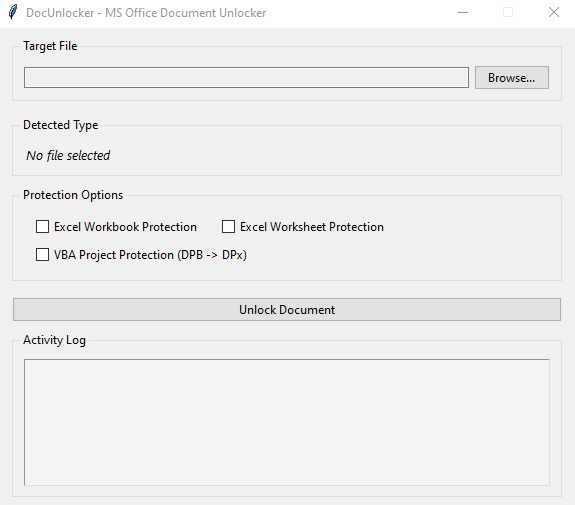
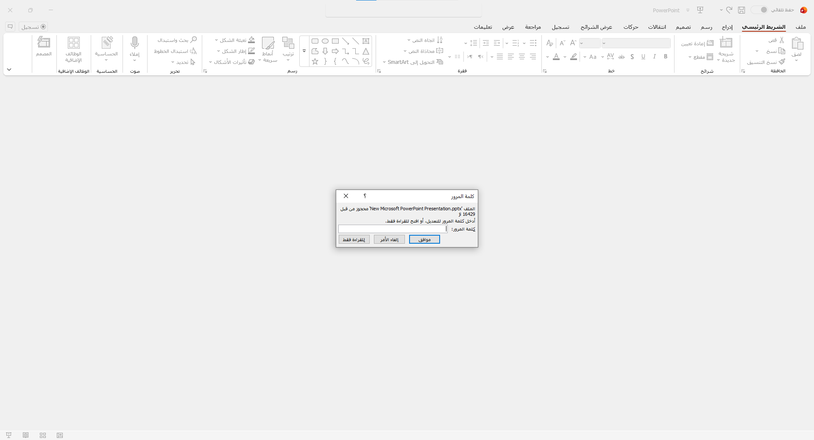
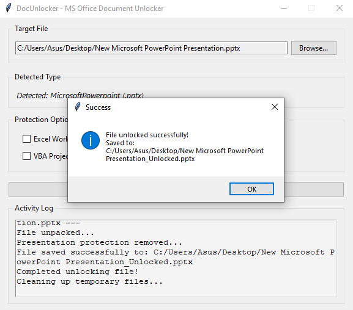
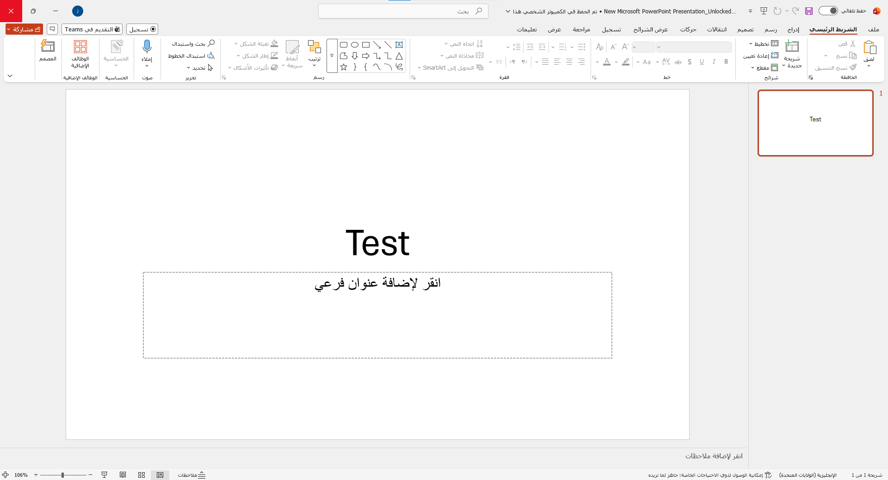

# 🔓 DocUnlocker

> **Microsoft Office Document Protection Removal Tool**

DocUnlocker is a smart, lightweight tool designed to remove restrictions and protections from files created using the Microsoft Office suite (Excel, Word, PowerPoint) with a single click—without the need for password guessing or consuming system resources.

---

## 🌟 Key Features

### 1. Unlocking Excel Files (`.xlsx`, `.xlsm`)
The tool provides comprehensive support for spreadsheet formats through 3 independent control options:
* **Workbook Protection Removal:** Unlocks the file structure to allow renaming worksheets, unhiding/hiding sheets, or moving and modifying their structure.
* **Worksheet Protection Removal:** Removes cell protection locks to freely allow editing, data entry, and modification of formulas and formatting.
* **VBA Project Protection Removal:** Bypasses password protection on code and macros by modifying the standard encryption header (`DPB` $\rightarrow$ `DPx`) to open the VBA editor instantly.

### 2. Unlocking Word Documents (`.docx`, `.docm`)
Supports text document formats with full editing restoration:
* **Write & Document Protection Removal:** Disables "Read-Only" mode and editing restrictions within documents, granting full permissions to write, copy, and edit content.

### 3. Unlocking PowerPoint Presentations (`.pptx`, `.pptm`)
Handles presentation file formats:
* **Edit Protection Removal (Modify Verifier / Read-Only):** Removes password protection imposed to prevent editing, allowing the file to open immediately in editing mode without prompting for a password.

---

## 🚀 Technical Highlights & Performance

* **Data Integrity:** Preserves original file content and formatting without corruption.
* **Auto-Detection:** Automatically identifies the document type upon import.
* **Modern GUI:** Built with a clean, responsive, and intuitive user interface.

---

## 🛑 Important Note

> **Disclaimer:** This tool is specifically designed to remove **internal editing and structural layout restrictions**. It does **not** apply to full file-opening encryption (*"Password to Open"*).

---

## 📸 Screenshots

  
  

  
  

